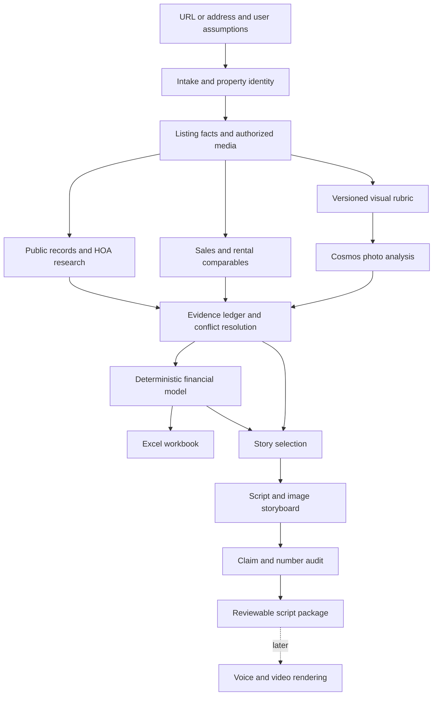

# Property analysis architecture and implementation plan

Draft for review • October 2 2026

Build one application that turns a property URL or address into a sourced research dossier, an editable financial workbook, and a bold video script tied to the actual listing photographs. The first release ends at a reviewed script and storyboard. Video rendering comes next.

The recommended architecture is a **modular Python application with typed tools and reusable skills**. Cosmos performs visual understanding; ordinary code handles retrieval, accounting, storage, and validation; a language model turns supported findings into an engaging story. All interfaces share the same underlying functions, so using a skill, the web app, or a CLI produces the same records and calculations.

This is a proposed build plan, not an implementation report. The starter repository has been inspected; VM access and live API compatibility have not been verified in this planning pass. Application implementation and deployment await your review.

## 1 Product and first release

The customer is a realtor who wants to attract potential buyers and sellers by investigating interesting listings, including listings represented by other agents. The story can conclude that a property is attractive, overpriced, worth negotiating, less compelling than renting, or impossible to judge without more information.

The editorial promise is: **“Is this home worth the money, and what would you miss by looking only at the listing?”**

### First release deliverables

| Deliverable | What the user gets |
|---|---|
| Property dossier | Identity, listing facts, history, sources, contradictions, missing documents, and decisive follow-up questions |
| Photo gallery | Original photos, Cosmos descriptions, separate analytical observations, confidence and limitations |
| Comparable analysis | Sale and rental candidates, inclusion rationale, meaningful differences, dated prices and statuses |
| Financial workbook | Editable inputs, loans, NOI, cash flow, rent versus buy, scenarios, sensitivities and sources |
| Script package | Three hook options, one selected 60–90 second script, photo storyboard, overlays, caption and CTA |
| Evidence review | A way to click each important claim or number and inspect its supporting source, image or calculation |
| Conversation | Follow-ups such as “What if I put 30 percent down?” or “Why did you exclude that rental?” |

Recommend **San Francisco condos as the initial research jurisdiction**, because the supplied examples make an excellent acceptance set. The interface accepts other addresses, but clearly indicates unavailable local research coverage. A national public-records system is a later expansion.

Accept a URL or address as input; do not promise every website can be scraped. If a URL cannot be read, request the address or allow listing details and authorized photos to be supplied manually.

Not in the first release: avatars, native video generation, automated posting or DMs, nationwide court-record coverage, a production multi-user SaaS, or guaranteed virality. The Excel model is part of the first release, not a deferred extra.

## 2 What the starter repository contributes

The inspected repository is primarily a workshop guide and a library of operational skills. It is not yet the property application. Preserve it and add the application under its existing tools convention.

The workshop describes shared GPU services, an existing VSS backend, VAST storage and indexing, W&B inference, and deployment to the team Kubernetes namespace. Its prescribed demo location is the existing team host under `/app`. See the local [build guide](/Users/zohrehalavi/vast-builders-challenge/BUILD_DAY.md), [architecture reference](/Users/zohrehalavi/vast-builders-challenge/ARCHITECTURE_REFERENCE.md), and [deployment guide](/Users/zohrehalavi/vast-builders-challenge/.cursor/skills/deployment/deploy-app-no-registry/SKILL.md).

| Workshop component | Proposed product role | Initial requirement |
|---|---|---|
| Cosmos Reason | Describe property images and answer rubric-based visual questions | Required; prove actual image inference first |
| W&B Serverless Inference | Generate research questions, synthesize evidence and write scripts | Default runtime language-model provider; confirm supplied model access |
| W&B tracing | Inspect stage latency, model usage, failures and prompt versions | Include when credentials permit |
| VAST S3 | Store authorized photos, source snapshots and versioned run artifacts | Use an approved application location outside watched ingest inputs |
| Existing VSS APIs | Search and ask over authorized, relevant property video if supported | Conditional on corpus and ingestion compatibility |
| Cosmos Embed and VastDB | Search property evidence or video segments semantically | Extension after confirming supported writes and scope |
| DataEngine | Existing video analysis and indexing pipeline | Preserve shared graph; use only supported operations |
| YOLO | Optional object detections in property video | Not a substitute for architectural or condition analysis |
| Canary | Optional transcription of an existing narrated tour | Speech recognition, not voice-over synthesis |
| Team Kubernetes deployment | Deliver the working demo at the workshop URL | Required for the final workshop demo |

The starter’s `ask-cosmos` skill is a workshop support workflow. “Cosmos” also appears in the workshop community branding. The image-analysis integration must specifically call **NVIDIA Cosmos Reason** through the GPU API.

### Resolve these repository contradictions first

1. **GPU configuration:** the architecture reference says no token is needed and hosts may differ; GPU skills use a bearer token and a shared hardcoded host. Read the actual team configuration and test the service. Do not copy example addresses over configured endpoints.
2. **Image payload support:** the provided Reason smoke test is text-only. A successful “OK” response does not prove photographs work. Verify a real image payload, response schema and model identifier.
3. **New media ingestion:** the architecture reference says the challenge operates on already indexed segments and does not run new chunk ingestion; an upload skill also exists. Confirm with the workshop environment and organizers whether new property media is supported and permitted.
4. **Artifact storage:** chunk and segment buckets belong to the ingest pipeline. Obtain an approved application bucket or prefix that cannot accidentally trigger ingestion.
5. **Hackathon fit:** the starter emphasizes video search and actions on the VSS corpus. Confirm whether direct Cosmos analysis plus W&B, VAST storage and cluster deployment satisfies the judging requirements. If use of the indexed video loop is mandatory, relevant authorized property footage becomes a first-release dependency.

These are compatibility decisions, not reasons to rebuild the shared infrastructure. Do not imply that unrelated traffic or warehouse footage is evidence about a property. A photo-only product should not be presented as a completed video-search integration.

## 3 Application structure

Use **Python 3.12, FastAPI, Pydantic, a small server-rendered interface with light JavaScript, and a single background worker**. This keeps the application small enough for the starter’s deployment method and makes HomeHarvest, document parsing and financial calculations straightforward.

Use one deployable application with separate modules. A message broker, distributed workers and a large agent framework are unnecessary for one-property-at-a-time operation.



Research, comparable discovery and image analysis can overlap after identity resolution. They merge into a versioned evidence set before financial and narrative outputs are finalized.

### Module boundaries

| Module | Responsibility | Explicit boundary |
|---|---|---|
| Intake | Resolve address, exact unit, parcel and building | Does not silently pick between ambiguous units |
| Acquisition | Fetch listing data, files and source snapshots | Does not decide that a listing claim is verified |
| Research | Search records, history, HOA and context | Returns evidence and open questions, not invented certainty |
| Comparables | Normalize candidates and explain comparability | Does not turn a removed listing into an executed lease |
| Vision | Build rubric and call Cosmos for image observations | Does not diagnose hidden structural conditions |
| Finance | Calculate dated, reproducible scenarios | Does not ask an LLM to do the arithmetic |
| Story | Select supported hooks and assemble scenes | Does not invent facts to improve a hook |
| Audit | Check identity, citations, numbers and scene support | Can block individual claims or an export |
| Exports | Build dossier, workbook and storyboard files | Reads approved versions, not raw model prose |
| Orchestration | Run stages, persist checkpoints and invalidate dependencies | Does not contain provider-specific HTTP details |
| Adapters | Encapsulate external APIs and storage | Return typed results and typed failures |

Domain modules depend on interfaces such as `ListingProvider`, `ResearchProvider`, `VisionProvider`, `LanguageModelProvider` and `ArtifactStore`. Provider-specific URL paths, credentials and retry behavior stay in adapters.

## 4 Where skills fit

**Yes: calling Cosmos should have a skill. The callable operation underneath it should be ordinary application code.**

A skill tells an agent when to use an operation, what inputs it needs, how to interpret its output, and what to do when evidence is missing. It does not grant network access, run a persistent service, or replace a schema or financial calculation.

For example:

- The `analyze-property-images` skill explains how to select photos and a rubric.
- It invokes `analyze_images(property_id, media_ids, rubric_version)`.
- That function calls the Cosmos adapter and validates the response.
- Both the web interface and an agent use that same function.
- Observations and their image references enter the evidence ledger.

Proposed reusable skills:

| Skill | Workflow |
|---|---|
| Analyze property | Run the end-to-end workflow, present unresolved identity or evidence questions |
| Research property | Gather public history and HOA documents, record conflicts, prioritize follow-up research |
| Evaluate comparables | Select candidates, distinguish price types, explain differences and assumptions |
| Analyze property images | Apply a property-specific rubric through Cosmos and preserve image references |
| Model property finances | Collect assumptions, call deterministic calculations and generate the workbook |
| Create property story | Choose supported hooks and produce a timed script with matched images |
| Audit property package | Verify provenance, financial consistency and unsupported wording |

Reuse the starter’s GPU health, retrieval and deployment skills for workshop operations instead of rewriting them. Add application skills beside them. Keep machine-readable schemas, rubrics and narrative templates inside the application package; skills reference those files rather than duplicate them.

Codex and Cursor do not necessarily discover the same skill directories. Provide a small documented loader or agent-specific registration that explicitly references the canonical skills. Test skill discovery in the chosen VM agent. Do not assume that copying a file into `.cursor/skills` makes it available everywhere.

GPT-6 Astra can act as the coding or orchestration agent when available through the user’s Codex setup. The deployed app should not require a personal interactive Codex login. Default runtime language-model work to the workshop provider behind an interchangeable adapter. Later image-to-video and speech synthesis require separate media-generation tools.

## 5 Proposed repository layout

All paths below are proposed additions within the existing repository.

```text
tools/property-studio/
  main.py
  pyproject.toml
  requirements.lock
  property_studio/
    api/                    routes and application authentication
    ui/                     templates and static assets
    domain/                 typed records and shared interfaces
    orchestration/          stage graph, checkpoints and budgets
    intake/
    acquisition/
    research/
    comparables/
    vision/
    finance/
    story/
    audit/
    exports/
    adapters/
      homeharvest.py
      public_web.py
      sf_records.py
      cosmos_reason.py
      wandb_inference.py
      vss.py
      vast_s3.py
    resources/
      prompts/
      rubrics/
      schemas/
  tests/
    unit/
    integration/
    fixtures/
  deploy/                   team-scoped manifests and packaging
.cursor/skills/
  property-analyze/
  property-research/
  property-comparables/
  property-images/
  property-finance/
  property-story/
  property-audit/
docs/plans/
  property-analysis-architecture.md
```

Keep external records, private documents, media and credentials outside source control. Use clearly labeled synthetic fixtures in tests. Adopt the approved plan into `docs/plans` when implementation starts; the current review copy is saved outside the project.

## 6 Data contracts and evidence

Every artifact must identify the property, run, evidence version, assumptions version and generating code or prompt version.

| Record | Essential fields |
|---|---|
| PropertyIdentity | Canonical address, exact unit, jurisdiction, coordinates, parcel identifier when known, building and association aliases |
| SourceRecord | Original URL or supplied document, publisher, retrieval time, event date, page or excerpt, snapshot hash, access status |
| Claim | Assertion, subject, source references, evidence type, confidence rationale, conflict state and usage restrictions |
| MediaAsset | Original source, property association, content hash, dimensions, retrieval date, permission or use status |
| ImageObservation | Media ID, description, rubric criterion, visible evidence, limitations, model and prompt versions |
| ListingEvent | Unit, event date, status, asking or transaction price, original feed and source |
| Comparable | Identity, price type, date, terms, quantitative differences, qualitative differences, inclusion rationale |
| HOAObligation | Association, purpose, status, amount, allocation basis, due dates, paid balance and responsibility if documented |
| FinancialScenario | Sourced inputs, explicit assumptions, calculation version, outputs and sensitivity ranges |
| ResearchQuestion | Missing fact, why it matters, likely source, effort estimate and conclusion it could change |
| StoryScene | Narration, approximate duration, overlay, media IDs, claim IDs and calculation IDs |
| RunManifest | Stage states, input hashes, output references, provider versions, costs, errors and timestamps |

Represent **reported facts, visual observations, calculated scenarios, hypotheses and unknowns separately**. Track conflicts independently from evidence type. A source reporting a fact is not automatically independent verification.

A claim must retain both event date and retrieval date. An old rental listing freshly crawled today remains an old rental listing. Multiple portals repeating the same feed count as one underlying observation.

Use the user’s pasted conversations as examples of desired questions and failure cases, not as verified property evidence. Keep the Stockton examples and the separate 15H example in different identities.

## 7 Intake and research workflow

### Listing acquisition

Resolve the URL to an exact address and unit using available structured metadata and visible listing text. If multiple matches remain, pause dependent property analysis while presenting the candidates.

Use HomeHarvest as the initial listing adapter. Its documented source is Realtor.com, with address searches and sale, rental and sold listing queries. Keep it replaceable because upstream coverage and responses can change. See [HomeHarvest documentation](https://github.com/ZacharyHampton/HomeHarvest).

Store original values before normalization. Preserve distinctions such as bedroom versus den, full versus half bath, listing square footage versus assessor square footage, and current asking price versus closed sale price.

Download permitted media with bounded request sizes and timeouts; deduplicate using hashes. Preserve the original photo and any analysis-sized derivative separately. Browser-assisted or manual acquisition is a fallback when the provider cannot supply the required data.

### Public history and HOA diligence

Start with official jurisdiction sources and supplied primary documents, then use listings and secondary reporting for leads.

Research ownership and transfer history relevant to the property, recorded encumbrances and releases, permit history and final approvals, code complaints and resolutions, planning and zoning, historic designation, and relevant development applications. Avoid publishing unrelated personal details about owners.

For an HOA, resolve the actual association and any master association before searching. Examine:

- Dues history, budgets, year-end reconciliations and true-ups.
- Reserve studies, contributions, funding gaps and upcoming replacement projects.
- Proposed versus approved assessments, amounts, allocation and payment schedules.
- Engineering reports, maintenance history and completed versus deferred work.
- Insurance coverage, deductibles, premium changes and documented nonrenewal.
- Association loans, aggregate delinquencies, rental restrictions and relevant litigation status.

Many decisive records will require an HOA or seller disclosure package. The output must distinguish “reviewed with no issue found,” “not publicly available,” and “not yet reviewed.” Missing records produce a document request checklist, not an all-clear badge. Financing eligibility remains subject to lender review; the app identifies evidence and questions.

For every assessment, determine whether it is proposed, approved, paid, outstanding or disputed. Do not apply the entire building assessment to one unit or infer a unit’s share from square footage without a documented allocation rule.

### Research depth and stopping rules

Maintain a queue of questions ranked by how much the answer could change the verdict. Examples: whether a higher floor clears an obstruction, whether an assessment is already paid, and whether a bathroom count is a marketing discrepancy.

Proposed starting limits: 12 images for initial analysis, up to 10 candidates per comparable category, 20 retrieved research pages and two refinement rounds. These are configurable budget limits, not promises of sufficient coverage. The user can request deeper research without rerunning completed stages.

Search and model access in this Codex conversation do not automatically exist inside the deployed app. Phase 0 selects and verifies a runtime search provider. If unavailable, the first app accepts supplied source URLs and documents and labels the research limitation.

## 8 Comparable analysis

Separate the following price types throughout the data model and interface: executed transaction, current asking price, historical asking price, automated estimate and our scenario estimate.

The supplied 333 Grant example is a required test: conflicting portal prices trigger a dated event timeline and a source reconciliation, not an average. A listing removed after two weeks does not prove a lease at the asking rent.

Rank candidates using geography, date, building, property type, size and room counts. Then explain meaningful differences: floor, outlook, obstruction, outdoor space, laundry, condition, parking, amenities, furnishings and lease terms.

For rentals, calculate net effective rent when concessions are known and separate included parking or utilities. For sales, retain concessions and transaction date when available.

Use same-building evidence heavily when relevant, while still checking unit differences. Prevent double-counting correlated features such as floor, view and a “penthouse” label. No automatic 15–20 percent premium: adjustments need supporting evidence or an explicitly editable assumption.

Report a range and the quality of its support. If too few valid observations exist, show that limitation instead of manufacturing precision. The app should explain why a candidate was excluded as clearly as why another was included.

## 9 Cosmos image analysis

Generate a constrained rubric from property type, known facts, comparable differences and open questions. Save it before inference so results can be reproduced.

Ask for two separate outputs per photo:

1. **Description:** literal, useful scene details for narration and image matching.
2. **Analysis:** observations against specific criteria, with visible evidence and uncertainty.

Initial criteria include room identity, apparent finishes, visible condition, storage, outdoor space, view obstructions, lighting appearance, staging, and suitability for a storyboard scene.

Cosmos responses must include image IDs and schema-valid observations. Parse and validate the result; make at most one schema-repair attempt before recording a structured failure. Preserve raw responses privately for debugging with appropriate retention.

Do not infer hidden damage, building compliance or actual daylight exposure from listing photos. Bright or overexposed photography raises a question; it does not prove deception. Window orientation requires a verified floor plan or other directional evidence. A tour’s room order must come from actual evidence, not invented spatial continuity.

Phase 0 tests a single real property image. Phase 1 verifies several distinct rooms and checks that returned details correspond to the correct images. If the endpoint only accepts video, confirm an allowed documented representation or endpoint change before building around it. A text-only success is not an acceptable substitute.

## 10 Financial engine and Excel workbook

Financial calculations are deterministic Python functions with explicit currency, frequency, dates and rounding. Models can propose inputs or explain results; they cannot silently fill missing values or supply the arithmetic.

Each input is labeled as sourced, user-provided, assumed or missing. Rates carry an as-of date and distinguish a market benchmark from a borrower-specific quote. Historical seller taxes are not automatically the buyer’s taxes; California change-of-ownership and supplemental assessments need their own treatment. See the [California Board of Equalization](https://boe.ca.gov/proptaxes/supplemental-assessment/).

### Core calculations

| Output | Definition and treatment |
|---|---|
| Loan payment | Amortizing payment from principal, rate and term; explicit zero-rate case |
| Initial cash invested | Down payment, closing costs, points and applicable upfront work or obligations |
| Effective rental income | Gross scheduled rent less vacancy and credit loss, plus other income |
| NOI | Effective rental income less operating expenses; excludes debt service, income tax, depreciation and capital expenditures |
| Cap rate | Annual NOI divided by purchase price, with the denominator displayed |
| Rental cash flow | NOI less debt service and separately identified capital reserves or spending |
| Cash on cash | Annual cash flow divided by initial cash invested, with the definition visible |
| Debt service coverage | Explicitly defined NOI divided by annual debt service; distinguish lender-specific adjustments |
| Rent versus buy | Monthly cash requirements and terminal wealth under a chosen holding period |
| Sensitivities | Purchase price, rent, financing rate, HOA dues, assessments and holding period |

Expenses cover property taxes, insurance, HOA, maintenance, management, owner-paid utilities and applicable rental costs. Avoid counting expenses twice when HOA dues already cover them.

Separate recurring HOA dues from special assessments. Model approved obligations in the appropriate base case and proposed obligations as scenarios. Preserve lump-sum versus installment timing. Capital assessment treatment must not silently distort recurring NOI.

Rent versus buy includes closing and selling costs, outstanding loan balance, equity, down-payment opportunity cost, investment of monthly savings and rent growth. Appreciation and investment return are explicit scenarios, not forecasts. Account for principal through cash flow and terminal equity without double-counting it. Tax benefits are off by default unless assumptions and jurisdiction treatment are provided.

Missing support for rent produces an incomplete rental model or a clearly named hypothetical rent scenario. It does not produce a confident investment verdict.

### Workbook structure

Tabs: Summary; Inputs and Sources; Sales Comps; Rental Comps; Loan and Amortization; Rental Operations; Rent versus Buy; Sensitivities; Property History; HOA; Open Questions.

Include comparable thumbnails where useful and authorized. Use formulas and consistent input formatting so the workbook is genuinely editable. The application model and spreadsheet formulas come from the same calculation specification.

Validate independently with hand-calculated fixtures and spreadsheet recalculation. Verify that exported values agree with the application within documented rounding tolerances. Select the workbook library and available recalculation engine during implementation.

Changing a scenario in the app creates a new version and invalidates affected script numbers. Editing an exported workbook does not automatically update the app; either regenerate through app inputs or implement a later explicit import path.

## 11 Turning evidence into an entertaining story

Use the MrBeast production material as an editorial reference: establish an immediate promise, deliver interesting evidence early, maintain progression and pay off the central question. Adapt those principles to a short property investigation; they do not establish that a video will go viral. Reference: [the production guide mirror reviewed](https://readwise-assets.s3.amazonaws.com/media/wisereads/articles/how-to-succeed-in-mrbeast-prod/How-To-Succeed-At-MrBeast-Production.pdf).

The story engine first selects interesting supported findings, then writes the narrative. Suggested selection criteria are surprise, relevance to a buyer, visual clarity and strength of evidence. Evidence eligibility is a hard requirement rather than a score that a sensational hook can outweigh.

A typical structure:

| Approximate time | Purpose |
|---|---|
| 0–5 seconds | Price question and an actual striking image |
| 5–20 seconds | The appealing feature that earns attention |
| 20–40 seconds | A sourced complication, contradiction or unanswered question |
| 40–65 seconds | A compact financial comparison, including rent versus buy when useful |
| 65–80 seconds | Conditional verdict and the fact that could change it |
| Final seconds | Realtor CTA offering the full analysis |

Durations are editorial targets until measured against generated narration.

Produce three hook variants, one selected script, scene-by-scene images, overlay text, caption, and a suggested comment keyword and DM reply. Do not send or publish them automatically.

Keep the tone playful and sharp. “This kitchen has main-character energy. So does the monthly payment” can work when the payment is calculated. “The HOA is hiding a disaster” cannot come from missing documents.

Use “what the asking price doesn’t show” or “what we still need from the HOA” when supported. Do not imply Zillow or a seller deliberately concealed facts without evidence. Clearly distinguish allegations from findings and resolved issues from active ones.

Every numeric overlay points to a calculation ID. Every factual sentence points to claims. Every visual scene points to a real asset. Public wording must preserve material uncertainty; private source annotations alone do not fix an overconfident spoken claim.

For later evaluation, measure retention, shares and qualified inquiries per 1,000 views. Initial hook scores are editorial rankings, not predicted engagement probabilities.

## 12 Orchestration and application interfaces

Use explicit stage states: pending, running, completed, partial, blocked, failed and cancelled. Identity ambiguity blocks dependent work. An unavailable HOA document allows a partial dossier but blocks unsupported HOA conclusions. A Cosmos failure must be visible and cannot be relabeled as completed visual analysis.

Persist a stage result before marking it complete. Use a content hash of inputs plus prompt, schema and calculation versions for caching. Retries reuse completed outputs; retry transient rate limits and server failures with bounded backoff, not unlimited loops.

Proposed interfaces:

| Interface | Purpose |
|---|---|
| POST /api/runs | Create a run from a URL or address; return a run ID immediately |
| GET /api/runs/{id} | Status, stage progress, artifacts and open questions |
| POST /api/runs/{id}/documents | Attach authorized supporting documents |
| POST /api/runs/{id}/scenarios | Create a new financial assumptions version |
| POST /api/runs/{id}/questions | Answer a follow-up using recorded evidence and approved tools |
| POST /api/runs/{id}/regenerate | Rerun invalidated stages explicitly |
| GET /api/artifacts/{id} | Authorized artifact download |

CLI commands should call the same service functions: doctor, analyze, research, images, finance, script, audit and export. An MCP wrapper can expose these later if needed; it is not necessary to complete the first release.

A rent change invalidates finance, workbook and affected story sections, not image analysis. New HOA documents invalidate relevant claims and dependent calculations. A new narrative style reruns story and audit only.

Use a single worker and a single active property run initially. Store canonical snapshots and run manifests in approved S3 storage; use SQLite for local indexing and queue state. Rebuild the index from manifests after restart. Interrupted stages are rerun safely. If no durable storage is available, label the environment temporary and resolve persistence before claiming restart recovery.

## 13 Storage and operational safeguards

Partition artifacts by team, property, run and version. Keep raw evidence immutable and derived outputs replaceable by new versions. Record retention and deletion behavior for uploaded documents.

The public listing fetcher must reject private-network targets, unsafe redirects and oversized responses. Trusted Cosmos, VSS and S3 clients use separately configured internal endpoints; they are not reachable through user-supplied URL fetching.

Treat web pages, PDFs and listing text as data. Embedded instructions must not become agent instructions. Parse files with size and time limits. Sanitize spreadsheet text that could be interpreted as a formula.

Keep credentials server-side, redact logs and use the actual team config without printing secrets. Scope access to the correct team and property. Authenticate the app and protect downloads; possession of the public workshop URL must not reveal private disclosures.

W&B traces should record stage names, versions, latency, usage and evidence IDs. Avoid logging secrets, complete private documents or image base64 by default. Workshop inference endpoint and model availability must be confirmed with the supplied credentials; public documentation has moved under CoreWeave. See [the current provider page](https://www.coreweave.com/products/coreweave-forge/serverless-inference).

Track failures by provider and distinguish live outputs, cached live outputs and synthetic fixtures. A demo can transparently replay a saved successful run during an outage, but cannot present it as a fresh inference.

## 14 Deployment on the workshop environment

Develop against adapter fixtures where useful, then prove integrations from the workshop VM and from the deployed pod. Laptop access does not establish VM access, and VM access does not establish pod access.

Follow the existing no-registry approach: public Python image, application code in a ConfigMap, credentials in a Secret, and Deployment, Service and Ingress in the team namespace.

The nested package needs deliberate packaging. A simple directory-to-ConfigMap command does not recursively preserve an entire Python package. Create a deterministic compact archive or explicit key-to-path mapping, verify its size against the approximately 1 MiB guidance, and verify imports after mounting.

Keep photos, documents and generated workbooks outside the ConfigMap. Pin dependencies and verify package installation or an approved wheel source from the pod. Do not assume FFmpeg, a browser or a spreadsheet recalculation engine exists in the slim Python image.

Use the actual kubeconfig and team ingress host. Internal routes remain at root while public links, redirects, static assets and downloads correctly respect the ingress `/app` prefix. Preserve the existing VSS frontend and shared DataEngine deployment.

Check health, authentication, one complete property run, download links and restart behavior through the public app path. Produce a submission description naming only integrations actually demonstrated.

## 15 Implementation sequence and exit criteria

### Phase 0 Prove the environment and product fit

Read the real team configuration through the authorized VM connection. Verify Kubernetes namespace, ingress, network access, GPU authentication, W&B model access, runtime search and application storage.

Run one real Cosmos photo inference. Verify VSS login and a scoped search as a separate workshop capability check. Resolve new property-media ingestion and judging requirements before committing to a video-indexing path.

**Exit:** a capability matrix with verified endpoints and payloads, one selected demo property, an approved storage location, and a clear decision about whether property video ingestion is required. Missing capabilities remain explicit; no fabricated green checks.

### Phase 1 Build a thin working path

Add the application skeleton, core schemas, source ledger, run manifest and Cosmos adapter. Accept an address plus a few authorized photos. Return linked photo descriptions, a small sourced property summary and a preliminary storyboard.

Wire W&B language-model calls through the provider interface. Persist results and make them inspectable in a basic UI.

**Exit:** a real property image goes through live Cosmos and appears in a scene with the correct description and source. Synthetic fixtures may support tests, but cannot satisfy this exit.

### Phase 2 Add acquisition and comparables

Implement URL/address resolution, HomeHarvest, photo retrieval, event histories, provenance and candidate comp normalization. Add source URL and document uploads as fallbacks.

Implement stale-price reconciliation and explainable comparable selection.

**Exit:** reproduce the conflicting-rental-price test without confusing old asks, current asks or executed leases. Show exact-unit identity and defensible candidate inclusion or exclusion.

### Phase 3 Add finances and the workbook

Implement loan amortization, rental operations, HOA cash obligations, rent versus buy and scenario sensitivity. Generate the editable workbook from the shared calculation specification.

**Exit:** independently checked fixtures pass, workbook recalculation agrees, scenario changes update narrative numbers, and missing inputs remain visible.

### Phase 4 Add deeper research and the final script package

Implement the SF research adapter, HOA document extraction, historical timeline, decisive-question queue, visual rubric refinement, story generation and claim audit.

Deliver three hooks, one complete script, photo storyboard, caption, draft CTA/DM reply and the full dossier.

**Exit:** a reviewer can trace every material number and factual claim to a source or calculation; unsupported statements are removed or appropriately qualified.

### Phase 5 Ship and rehearse the hackathon demo

Package and deploy to the team namespace at `/app`. Verify storage, downloads, application authentication, tracing and recovery. Include the VSS property-media path here only if its prerequisites were confirmed in Phase 0; move it earlier if mandatory for judging.

Rehearse one full example and one assumption change. Keep a clearly labeled saved run available for external outages.

**Exit:** the app works from its public workshop path, demonstrated sponsor integrations are visible, and the submission accurately describes the working system.

### Phase 6 Add video after the script workflow is approved

Start with deterministic pans, crops, zooms, captions and licensed voice synthesis over original images. Keep real geometry and photo provenance.

Then evaluate an interchangeable image-to-video provider for selected scenes. Check generated frames for altered windows, rooms, finishes or views. Use actual photos when the motion output changes material details. Astra can orchestrate these calls; a separate renderer or video provider produces the video.

Add licensed neighborhood imagery only with verified location and permitted usage. Do not scrape unrelated YouTube footage or use generic street footage as property evidence.

## 16 Acceptance tests

| Case | Required behavior |
|---|---|
| URL points to an ambiguous building or unit | Resolve or request clarification before dependent analysis |
| Two portals show different rents | Preserve dates and statuses; reconcile or flag the conflict |
| Rental disappears from a portal | Record removal, not an assumed signed lease |
| One bedroom plus den versus two bedrooms | Preserve the distinction in comparability |
| Higher floor and better view | Avoid counting the same advantage twice |
| Conflicting bath counts | Flag unresolved facts in the dossier and script |
| Staged photograph | No automatic claim of vacancy, staging contract or seller desperation |
| Recorded old mortgage | No invented current balance or financing cost |
| HOA records unavailable | Produce missing-document questions, not a clean HOA verdict |
| Assessment proposed or already paid | Use correct scenario and outstanding obligation |
| Model confuses two photos | Fail scene validation instead of attaching the wrong narration |
| Zero-rate loan or missing rent | Correct edge-case math or explicit incomplete model |
| Spreadsheet changes assumptions | Formula outputs recalculate; app does not pretend to have imported changes |
| Script contains an unsupported number | Block or repair the claim before final export |
| Website contains instructions for the agent | Treat them as source text, not executable instructions |
| New evidence or assumption arrives | Invalidate only affected outputs and mark stale versions |
| Service outage or pod restart | Resume safely and distinguish cached from live results |
| Wrong team or property scope | Reject access and prevent cross-property evidence leakage |

Use unit tests for financial and evidence rules, recorded adapter fixtures for repeatable integration tests, and a small live smoke suite for the actual workshop services. Avoid repeatedly rerunning expensive inference once the relevant integration is proven unless code or configuration changes.

## 17 Review decisions and build priorities

Recommended decisions to approve:

1. One modular Python application, with skills as reusable playbooks over typed application tools.
2. Live Cosmos visual analysis from the first working slice; W&B as the default runtime language-model provider.
3. Script, storyboard, source dossier and editable Excel workbook in the first release.
4. SF condo research first, with a clear generic fallback elsewhere.
5. VAST storage and workshop deployment from the core plan; VSS property-video integration governed by the Phase 0 compatibility decision.
6. Video rendering, avatars and posting after the factual script workflow works.

Before execution reaches live integration, we need the authorized VM connection or an established way to operate its terminal, the correct team configuration, a demo property, and agreement on run budgets. Credentials should remain in the environment rather than pasted into the plan.

If time is tight, reduce supported jurisdictions, image count, UI polish and the number of narrative variants. Preserve identity checks, source provenance, real Cosmos use, transparent financial assumptions, the workbook, and an honest account of which workshop components were demonstrated.

The implementation order is intentionally designed to expose the two biggest risks early: whether the actual Cosmos endpoint accepts property photographs, and whether this property use case satisfies the challenge’s expected use of its video stack.
